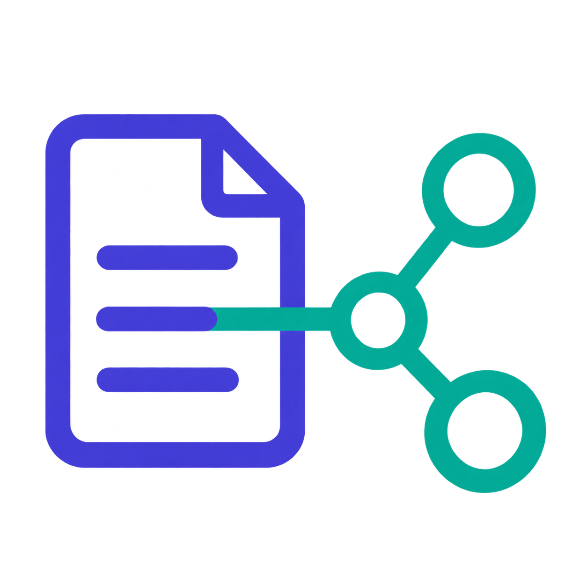
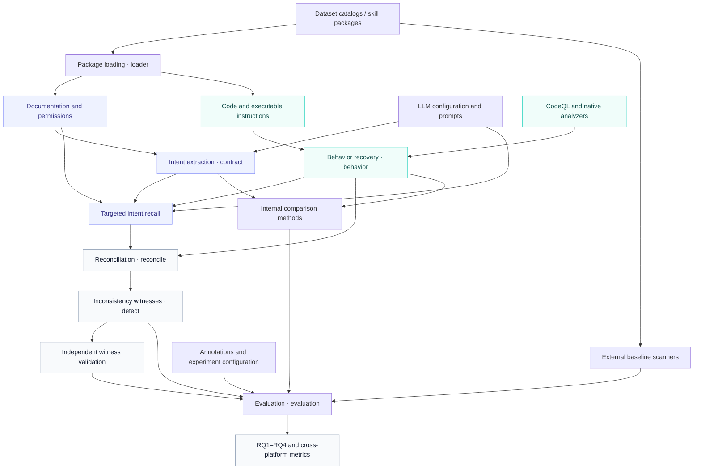

<p align="center">
  
  &nbsp;
  <picture>
    <source media="(prefers-color-scheme: dark)" srcset="assets/skillrecon-wordmark-dark.svg">
    <source media="(prefers-color-scheme: light)" srcset="assets/skillrecon-wordmark-light.svg">
    
  </picture>
</p>

<p align="center">
  <strong>Witnessing Intent–Behavior Inconsistency in Agent Skills</strong>
</p>

<p align="center">
  <a href=".github/workflows/ci.yml"></a>
  <a href="#setup"></a>
  <a href="https://github.com/github/codeql-cli-binaries/releases/tag/v2.27.3"></a>
  <a href="LICENSE"></a>
</p>

<p align="center">
  <a href="#overview">Overview</a> &nbsp;·&nbsp;
  <a href="#architecture">Architecture</a> &nbsp;·&nbsp;
  <a href="#setup">Setup &amp; Usage</a> &nbsp;·&nbsp;
  <a href="#data">Data &amp; Hyperparameters</a> &nbsp;·&nbsp;
  <a href="schemas/README.md">Input Formats</a>
</p>

---

## Overview

SkillRecon checks whether an agent skill's implementation conforms to its documented authorization. It extracts capability and scope contracts from documentation, recovers behavior across code artifacts, reconciles the two, and produces verifiable inconsistency witnesses.

| Intent Extraction | Behavior Recovery | Reconciliation | Verifiable Witnesses |
|:---:|:---:|:---:|:---:|
| Ground documented capabilities and scope constraints. | Recover behavior and verified flows across artifacts. | Check capability, scope, and path authorization. | Export evidence for independent revalidation. |

The artifact provides the four-stage method, twelve comparison methods, ablations, documentation perturbations, hyperparameter experiments, and evaluation for RQ1–RQ4 and cross-platform generalization. Supported inputs include OpenClaw skills, Claude Code packages, and opencode packages.

## Architecture



<a id="setup"></a>

## Setup & Usage

Use Linux with Python 3.12 or 3.13 and [CodeQL CLI 2.27.3](https://github.com/github/codeql-cli-binaries/releases/tag/v2.27.3).

### Installation

```bash
python3 -m venv .venv
source .venv/bin/activate
python -m pip install -e .

# Add the CodeQL executable to PATH, then install query dependencies.
codeql pack install experiments/codeql/queries/python
codeql pack install experiments/codeql/queries/javascript
```

### Model configuration

Copy the model configuration and set the service endpoint and model name. GLM, DeepSeek, and Qwen3.8 use the same Chat Completions interface.

```bash
cp experiments/configs/llm_config.json experiments/configs/llm.local.json
export SKILLRECON_API_KEY='YOUR_API_KEY'
```

Set `base_url` and `model` in `experiments/configs/llm.local.json` to your chosen service and model.

### Prepare data and run analysis

Dataset catalogs contain package identities and source versions. Prepare the selected packages into `data/packages/`:

```bash
skillrecon prepare --catalog datasets/main/catalog.jsonl \
  --output data/packages --limit 3

# For a local collection, add --source-root /path/to/extracted-packages.
# Omit --limit to prepare the complete collection.
skillrecon batch --skills-file datasets/main/skills.txt \
  --data-root data/packages --output-dir outputs/skillrecon \
  --llm-config experiments/configs/llm.local.json --limit 3
```

#### Analyze a single package

Use the package path relative to the data root:

```bash
skillrecon analyze --skill owner/skill --data-root data/packages \
  --output-dir outputs/skillrecon \
  --llm-config experiments/configs/llm.local.json

skillrecon replay outputs/skillrecon/owner/skill/witness_bundles/witness-0001.json
```

### Baselines

The six internal methods are Rule-based scanner, LLM-as-judge, Capability-lattice, Doc-code consistency, Spec containment, and Instruction constraints.

```bash
skillrecon internal-baselines --gold annotations/main.jsonl \
  --artifacts outputs/skillrecon --output outputs/internal \
  --llm-judge --llm-config experiments/configs/llm.local.json
```

Install the external scanners in their respective environments. Their public repositories and command identifiers are listed in [the baseline configuration](experiments/configs/baselines.json).

<details>
<summary><strong>External scanners and native scan imports</strong></summary>

```bash
skillrecon baselines --scanner baseline_cisco_skill_scanner \
  --skills-file datasets/main/skills.txt --data-root data/packages \
  --output-dir outputs/cisco_skill_scanner --limit 3

# Import an OpenClaw native scan export.
skillrecon baselines --scanner baseline_openclaw \
  --raw-json owner/skill=/path/to/native-scan.json \
  --output-dir outputs/openclaw

# Run native MalSkills with its selected model configuration.
skillrecon baselines --scanner baseline_malskills_full \
  --scanner-python /path/to/malskills-env/bin/python \
  --scanner-config experiments/configs/baselines/malskills-glm.toml \
  --skill-id owner/skill --skill-path data/packages/owner/skill \
  --output-dir outputs/malskills_full
```

MalSkills uses `MALSKILLS_LLM_BASE_URL` and `MALSKILLS_LLM_API_KEY`. DeepSeek and Qwen profiles are in the same configuration directory. External scanner options can be passed with `--scanner-arg`.

</details>

### Experiments

Configure the annotation paths and system outputs in `experiments/configs/evaluation.json`, then compute the experimental metrics. `comparison.json` provides the twelve-baseline configuration:

```bash
skillrecon evaluate --manifest experiments/configs/evaluation.json \
  --output outputs/evaluation
```

| Experiment | Inputs and measurements |
|---|---|
| RQ1 | Clause/operator recovery, POLICY/KNOWLEDGE classification, authorization gates, effective support, intermediate objects |
| RQ2 | High/Medium detection, type-specific and broadcast-free F1/TCR, ablations, language and documentation strata, perturbations, parameter/model comparisons |
| RQ3 | Low-slice discovery, precision/recall and exact binomial confidence intervals |
| RQ4 | Witness coverage, revalidation, irreducibility, extraction modes, grounding, tier contributions and runtime |
| Cross-platform | Claude Code/opencode detection and type recall, witness revalidation, paired McNemar with Holm–Bonferroni correction |

Generate the four ablations and documentation variants, and run parameter sweeps:

```bash
skillrecon ablate --skills-file datasets/main/skills.txt \
  --data-root data/packages --artifact-root outputs/skillrecon \
  --output-root outputs/ablations \
  --llm-config experiments/configs/llm.local.json

skillrecon perturb --plan /path/to/perturbations.jsonl \
  --source-root data/packages --output-root data/variants

skillrecon sweep --skills /path/to/selected-skills.txt \
  --data-root data/packages \
  --llm-config experiments/configs/llm.local.json \
  --grid experiments/configs/canonical_sweep.json --output outputs/sweep
```

Analyze each documentation variant with its own data root. Register ablation, variant, model, and parameter outputs in the evaluation configuration. The `sweep --dry-run` option writes the selected run plan.

For cross-platform experiments, prepare `datasets/cross_platform/catalog.jsonl` and run the two supplied platform lists through the same analysis and evaluation commands.

<a id="data"></a>

## Data & Hyperparameters

### Data organization

| Catalog / selection | Collection |
|---|---|
| `datasets/main/catalog.jsonl` | 1,500 versioned OpenClaw packages |
| `datasets/main/{high,medium,low}.txt` | 500 identities per slice |
| `datasets/main/skills.txt` | Complete main collection |
| `datasets/cross_platform/catalog.jsonl` | 500 packages with pinned repository revisions and source paths |
| `datasets/cross_platform/claude_code.txt` | 300 Claude Code packages |
| `datasets/cross_platform/opencode.txt` | 200 opencode packages |

Prepared data, annotations, and newly generated outputs use this layout:

```text
data/
  packages/<owner>/<skill>/       # Original package documents and source code
  variants/<kind>/<owner>/<skill>/
annotations/
  main.jsonl                     # Skill-level labels and grouping metadata
  cross_platform.jsonl
  rq1_clauses.jsonl               # Clause/operator/role annotations
  rq1_objects.jsonl               # Intermediate-object annotations
  witness_grounding.jsonl
outputs/
  skillrecon/<owner>/<skill>/     # Analysis and witness outputs
  internal/                      # Internal baseline outputs
  <scanner>/                     # External baseline outputs
  ablations/<configuration>/
  sweep/<configuration>/
  evaluation/                    # measurements.json and metrics/*.json,*.csv
```

Annotations and experiment manifests follow the [input schemas](schemas/README.md). Configure each system with an analysis directory, a report directory, or a prediction JSONL. Dataset catalog paths and platform/slice fields identify the selected experimental groups.

### Configurable parameters

The default method uses five extraction passes, a 0.6 voting threshold, eight candidate clauses, and exact witness bounds of 18 nodes / 36 edges.

<details>
<summary><strong>Model, method, and experiment settings</strong></summary>

| Setting | Default | Configuration / override |
|---|---|---|
| Model service, model, authentication | Local Chat Completions service; GLM profile | `llm.local.json`: `base_url`, `model`, `api_key_env`; `--base-url`, `--model`, `--api-key-env` |
| Temperature / output budget | 0 / 32,768 tokens | `temperature`, `max_tokens`; corresponding CLI options |
| Structured responses | `json_prompt` | `structured_output_mode`: `json_prompt` or `json_schema` |
| Response cache | `outputs/llm-cache`, live requests enabled | `cache_root`, `cache_only`; `--cache-root`, `--cache-only` |
| ICCM passes, n | 5 | `env_config.json` → `vote_policy.n_samples`; `--n-samples` |
| Vote threshold, θ | 0.6 | `vote_policy.agreement_threshold`; `--theta` |
| Candidate frontier, k_c | 8 | `reconciliation.max_candidates_per_behavior`; `--max-candidates-per-behavior` |
| Exact witness bounds | 18 nodes / 36 edges | `reconciliation.witness_max_nodes`, `witness_max_edges`; matching CLI options |
| Alignment candidates per step | 3 | `reconciliation.max_alignment_fallbacks_per_step`; matching CLI option |
| Semantic event / path candidates | 3 / 2 | `reconciliation.max_semantic_event_fallbacks`, `max_semantic_path_fallbacks`; matching CLI options |
| Capability vocabulary / coverage | `taxonomy_v3.json` / `overlap_policy_v2.json` | `experiments/configs/`; `--taxonomy-version`, `--overlap-policy-path` |
| Extraction prompts | `iccm/v2` | `experiments/prompts/`; `--prompt-version` |
| CodeQL executable | `codeql` from PATH | `env_config.json` → `codeql.bin`; `--codeql-bin` |
| Bash capability rules | `bash_patterns.json` | `experiments/configs/bash_patterns.json` |
| Experiment inputs | Main collection | `evaluation.json`: `gold`, `systems`, optional RQ/variant inputs |
| Sweep grid | n, θ, k_c, witness bounds | `canonical_sweep.json` or `sweep --grid` |
| Collection and run paths | Explicit data/output roots | `--catalog`, `--skills-file`, `--data-root`, `--output-dir`, `--limit` |
| External scanner runtime | Native scanner configuration | `--scanner-python`, `--scanner-config`, `--scanner-arg`; MalSkills TOML model, timeout and analysis-stage switches |

</details>

The ablation configurations are `ablation_no_iccm`, `ablation_no_scope_constraints`, `ablation_no_composition_analysis`, and `ablation_no_authorization_guard`. Documentation perturbations are `missing_authorization`, `stale_resource`, `ambiguous_scope`, and `conflicting_allow_prohibit`. Use `skillrecon <command> --help` for command options.

---

Released under the [MIT License](LICENSE).
